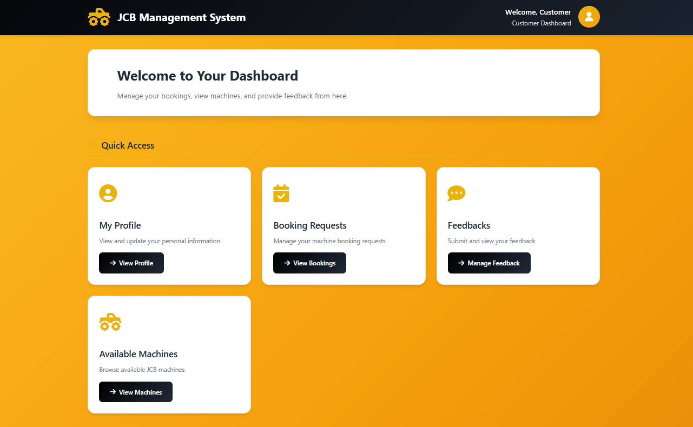
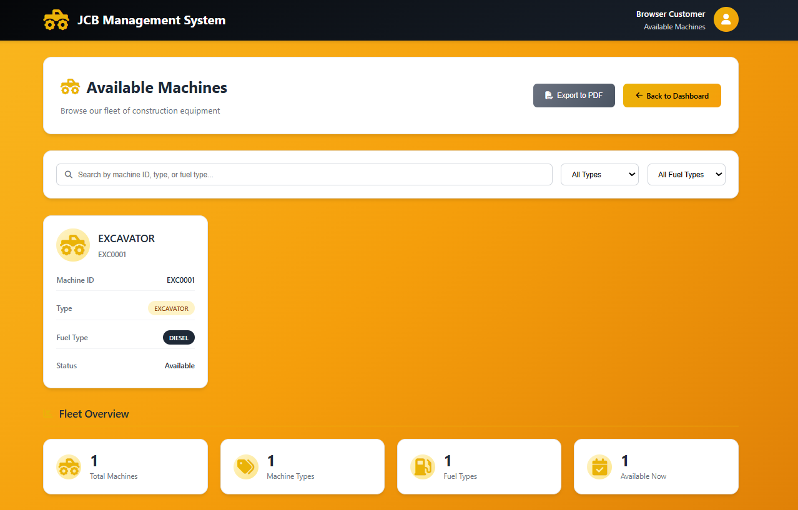
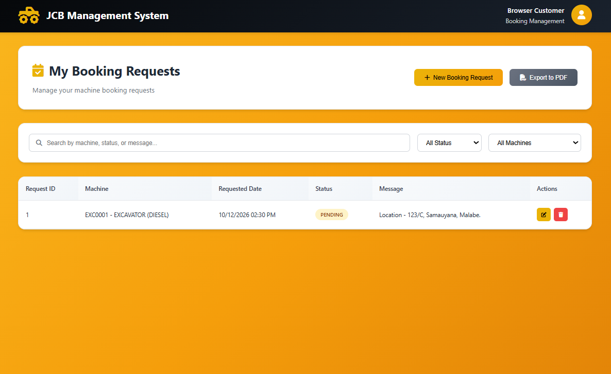
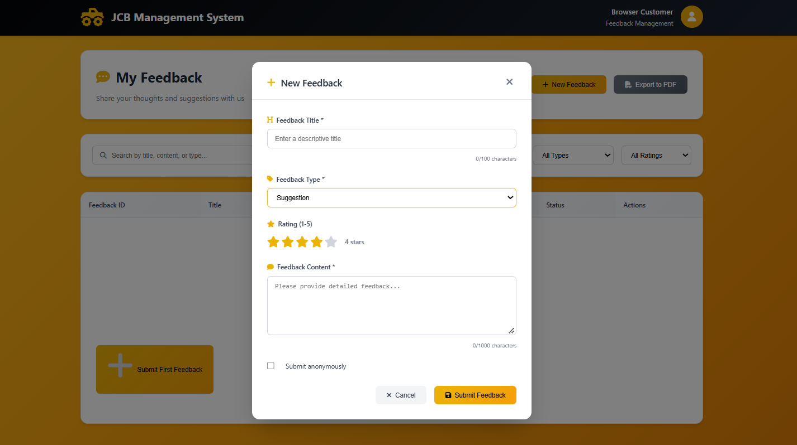

# JCB Management System

SLIIT Year 2 Semester 1 group project for managing JCB construction equipment, users, bookings, feedback, jobs, and invoices.

**Pubudu Dahanayaka — Assigned area: Feedback Management.**

This is a group project. The modules and application are credited to the group; the assignment above identifies my allocated area and does not claim individual implementation of the full system.

## Existing modules

- User registration, BCrypt login, profiles, roles, and user administration
- Machine management, machine types, fuel tracking, maintenance, and machine operations
- Customer booking requests and administrator booking management
- Customer feedback and administrator feedback management
- Machine jobs and invoice management
- Role-specific JSP dashboards for administrators, customers, operators, supervisors, and accountants

## Technology stack

- Java 17 language target
- Spring Boot 3.5.6
- Spring MVC and embedded Tomcat
- JSP/JSTL views under `src/main/webapp/WEB-INF/views`
- Spring Data JPA and Hibernate
- MySQL Connector/J for the normal database
- BCrypt password hashing
- H2 in-memory database for the isolated local demo

## Requirements

- JDK 17 or a compatible newer JDK
- No global Maven installation is required; the Maven Wrapper is included
- MySQL 8.x for persistent local development

## Configuration and database

The normal profile targets a local MySQL database named `jcbsystem` and uses `ddl-auto=update`. It reads connection values from `JCB_DB_URL`, `JCB_DB_USERNAME`, and `JCB_DB_PASSWORD`, so credentials are not stored in the repository.

For local MySQL credentials, copy [application-local.properties.example](src/main/resources/application-local.properties.example) to `application-local.properties`, fill in local values, and keep the copied file uncommitted. Do not point the application at a production database.

The [first_admin.sql](first_admin.sql) file is a template only. Its previous sample BCrypt hash was removed. Generate and insert a local BCrypt hash before running it, and run it only against an isolated database after reviewing the SQL.

## Build and run

From the directory containing `pom.xml`:

```powershell
.\mvnw.cmd -DskipTests package
java -jar target\demo-0.0.1-SNAPSHOT.jar
```

The normal profile uses port `8081` by default. Change `server.port` locally if that port is already in use.

### Shareable isolated demo

The repository includes [application-demo.properties](src/main/resources/application-demo.properties). It contains no credentials and uses an isolated, in-memory H2 database in MySQL compatibility mode:

```powershell
.\mvnw.cmd -DskipTests package
java -jar target\demo-0.0.1-SNAPSHOT.jar --spring.profiles.active=demo
```

The demo is available at `http://localhost:8082/login`. Its data is temporary and resets whenever the application restarts. Register a customer through the UI to create demo data.

After registration, login requires the generated **User ID** (for example, `CUS0001`), not the email address. The registration response/page provides this generated identifier. Enter the password chosen during registration.

## Screenshots

### Dashboard



### Machine management



### Booking management



### Feedback management



## Attribution and scope

This repository preserves the existing group implementation, source code, JSP pages, design-pattern examples, documentation, and screenshots. Individual contribution is limited to the assigned Feedback Management area; the complete system is a collaborative group project.
